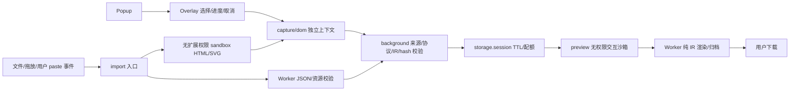

## v0.7.0 原尺寸PNG与ZIP-only · Decision

沿用IR1.4和唯一ZIP writer。`core/png.js` 有界解析PNG签名、CRC、块、IHDR与像素流；分块处理8位非隔行格式，解压长度严格等于scanline预算。RGBA字节通过过滤器解码与原生CompressionStream封装，避免Canvas预乘alpha量化。PNG颜色配置保留；灰度ICC不能套用到RGBA，分块拒绝并引导ZIP-only。16位、隔行也引导ZIP-only；动画拒绝，不悄悄截取首帧。精确两模式只接受PNG，标准JPEG/WebP路径保留。

`core/image-archive.js` 仅识别原尺寸导入器的精确1000px网格、空根属性、仅alt图片属性、尺寸/定位/资源一致的布局。合成完整PNG时逐块校验尺寸与颜色配置，拒绝混合配置；重组不缩放。`archive.js` 在原归档中附加 `resources/original.png` 并替换笔记图片引用，保留原来的内嵌分块JSON；预览PNG导出复用同一合成器。

ZIP-only是用户明确选择的另一存储契约，而非第二套导出器：复用预检与ZIP writer。≤16MB输入，≤8.4MP、单边12000、≤36MB PNG；解析/浏览器验证后仅保留像素与颜色块，去除元数据。直接打包HTML、notes、PNG、manifest、SHA-256；不传入capture/session、不生成snapshot.json，不提供JSON往返。页面取消后不触发下载；解码或压缩原生调用不能抢占，返回时检查signal。IR4MB、每资源2MB base64、原尺寸总2.5MB与会话预算均未放宽。

安全CSS扩展仅增加CSSOM实际展开的border/radius/overflow/columns/text-decoration属性，仍通过原safeCss与命名空间校验；schema同步生成，既有IR可直接读取。字体/公式诊断仅统计安全树和声明字体，不是字体文件检测或字形完整性证明。插件UI增加格式说明，不向导出内容插入品牌外框。

当前版本入口 `dist/v0.7.0/`，执行证据以[测试报告](../tests/TEST_REPORT.md)为准；以下为历史架构沿革。

---

## v0.6.0 当前实现 · Decision

本节覆盖下方 v0.5 历史说明中关于当前版本和标准截图唯一模式的描述。新增实现与证据见 [兼容性研究](COMPATIBILITY_REVIEW_0.6.0.md)。

IR1.4.0 新增允许属性 `start`（有序列表）和 `display`（MathML），捕获 `li.value`。没有新节点/资源模型；多块归档使用原有 div/img、绝对定位和资源数组。1.0/1.1/1.2/1.3 经原版本验证再迁移1.4；旧标签携带 start/display 明确拒绝；未知版本失败，v0.2仍经隔离HTML重新净化。旧阅读器不会被声称能打开1.4。外部JSON来源、脱敏和等价证据继续清除，各有限模型独立校验。

`import-raster.js` 标准模式保持原预检/受控缩放/JPEG后备。可选原尺寸模式先按文件头拒绝 >8.4MP 或单边>12000；原生解码一次最多8.4MP源图（RGBA像素约33.6MB），复用最多1MP画布（约4MB）逐块编码PNG。编码前后、hash后、校验后检查取消；原生解码/toBlob不能被抢占，返回后释放bitmap/清零canvas，取消不创建预览。不会保留完整未压缩像素数组。

每块≤1MP、≤2MB base64；构建字符串前检查编码字节增长，累计base64≤2.5MB；IR≤4MB、会话存储估算≤7.5MB继续执行；不增加存储权限。最多100资源，尺寸约束把840万像素的极细长图块数控制在原模型范围。高熵图片即使像素较少也可能拒绝；不会无声改成标准/JPEG。PNG重编码移除元数据，不保存源字节；JPEG/WebP仅保留其已解码像素，不能恢复原有有损信息。

Markdown采用块级列表递归、正确续行缩进、围栏处理；合并单元格只能输出经过IR校验的表格HTML，不开放任意HTML注入。MathML/SVG的MD继续显式指向HTML，避免伪造公式文本。多块ZIP的notes为分块图片序列，完整布局在index.html。未新增适配器。

原尺寸像素验证使用4K透明细字/单像素条纹，直接重组资源比较全部RGBA通道；另以全新无扩展浏览器断网打开下载文件。时间和JS堆/RSS采样为特定样本观察，不是硬内存界限或通用性能认证。字体、浏览器色彩转换、平台渲染仍有边界。

---

# v0.5.2 实际架构 · Decision

源码使用原生 ES modules，无前端框架、后端或生产 npm 库。esbuild 只将内容脚本和隔离导入器打成随包分发的 IIFE 与产品自有有限运行时；其他扩展页使用本地 ESM。

## 数据流与职责

| 文件 | 唯一职责 |
|---|---|
| `src/capture/picker.js` | 选容器、Overlay、清理监听、独立 AbortController、进度与重试 |
| `src/capture/dom.js` | 有界 DOM→树/样式/资源；每次新 omissions/stats/id 映射；不负责格式 |
| `src/core/policy.js` | 标签、属性、样式与 CSS 函数白名单、本地 SVG 引用规则 |
| `src/core/import-snapshot.js` | 外部JSON信任清除、版本迁移、逐项模型恢复、资源验证 |
| `src/core/ir.js` / `raster.js` | 版本、契约、有限状态、哈希/签名/编码像素检查、迁移、纯诊断 |
| `src/core/render.js` | 校验后的 IR→HTML/Markdown/JSON/SVG；不访问原网站 |
| `src/core/archive.js` | 确定性 ZIP STORE/CRC32、文件 SHA-256/manifest |
| `src/core/session.js` | TTL、最多3份、保守配额与淘汰 |
| `src/preview-scale.js` | 隔离frame显示缩放、占位尺寸与ResizeObserver清理；不读取/修改来源内容、IR或导出 |
| `background.js` | 发送者/消息/来源验证、串行会话写入、创建预览 |
| `import.js` / `src/import-sandbox.js` | 统一文件/拖放/粘贴路由与取消；未净化 HTML 永不进入有扩展权限 DOM |
| `src/jobs.js` / `src/worker.js` | 独立 Worker 校验/序列化/ZIP；超10秒 terminate |
| `preview.js` | 展示、格式最新任务隔离、有限 PNG、显式下载与过期状态 |

## Snapshot IR 1.3.0

机器结构见 [snapshot.schema.json](snapshot.schema.json)，完整安全语义以 `validateSnapshot` + `verifyResources` 为准。JSON Schema 不能代替样式函数、标签/属性组合、引用一致性和资源 hash 校验；CI 检查 schema 生成无漂移。

顶层：schemaVersion/kind、创建时间、来源类型与脱敏 origin、dimensions/background、tree、resources、provenance、capability、omissions、limitations、security、可选 stats。来源不保存查询串、路径、文件名或身份。节点含白名单 tag/ns/attrs/style/children、组件类型、有限滚动状态和来源 evidence；资源为允许栅格的 base64/MIME/SHA-256，不接收远程地址。

来源方法区分 DOM、local-file、raster-import、migrated-v02。节点 `captured` 和 `unsupported` 显式区分；静态树自身的能力仍为 `static` 或 `visual-only`。可选 behaviors 存储 recipe 名称/版本、数字节点路径绑定、有限 state 和有界证据标记；不存代码。分析器根据校验结果、来源入口和导出策略派生组件/文件能力，不把外部 evidence 当认证。有限状态记录不等于原生逻辑复原。它不是 ChatGPT 原生组件协议。

原生 1.3 快照读写；1.0/1.1/1.2 先按原版本验证再迁移 1.3。旧版本不得携带新增 recipe，1.0 不允许 behaviors，1.1 只接受旧证据枚举。未知版本失败关闭。外部入口始终清除来源、脱敏和等价声明；即使伪造 captured / fixture-equivalence，也只能得到 model-validated。v0.2 static-snapshot 的 HTML 必须重新经过隔离净化，缺失信息不恢复。

`import-snapshot.js` 先约束JSON字节/版本，强制local与external-unverified，剥离行为后验证基础树/资源；`interactions.externalImport` 再逐项独立验证候选（最多20），仅保留内置模型匹配项并重写证据。后台对导入消息重复执行该边界；资源完整性验证失败拒绝整个快照。未知或结构不符的行为保留静态树并产生诊断，不运行外部代码、字符串表达式或来源脚本。格式渲染器只读已校验IR；迁移不重新获取来源。

## 生命周期与有界处理

新增 `storage` 有必要性：SW 内存 Map 无法跨休眠恢复。只使用 `storage.session`，访问级别 TRUSTED_CONTEXTS；浏览器会话内保留，未写 local/sync。每条消息先验证发送者 id、页 URL/顶层 frame 与字段；capture 只允许允许的网页内容脚本或本地 importer，getCapture 只允许 preview。内容来源 origin 必须与 sender 一致。

保存最多3份；估算 UTF-8序列化×2 总量不超过7,500,000字节，以低于10MB API配额留余量。10分钟后拒绝读取；下一条消息清理过期记录，预览定时禁用下载并移除画布。没有 alarms 定时物理清理或安全擦除承诺。会话结束/扩展重载可更早失效。

| 边界 | 实施 |
|---|---|
| DOM/IR | 最多5000访问节点、75层、100万文本字符、4MB序列化IR |
| 尺寸 | 单轴1–100000；Canvas/栅格最多100万像素、单轴4096 |
| 文件 | HTML/SVG2MB，JSON4MB；截图输入16MB/40MP/单轴16384，保存资源仍≤1MP/4096；单资源base64≤200万字符，捕获资源总≤250万字符 |
| DOM遍历 | 预检入栈即限制总节点；每64节点让出，捕获每16节点让出并查取消 |
| Worker | 可 terminate 的10秒超时；每次独立任务，不共享不可信状态 |
| sandbox | 独立无权限 frame，15秒移除；浏览器单次原生同步调用不能保证硬抢占 |

单次 computedStyle、Canvas、解码与 DOMParser 属浏览器原生调用；协作取消不是硬 CPU 超时。图片先读编码尺寸再解码；文件/树/像素限额降低峰值，不能承诺任意敌意网页在共享渲染线程绝不卡顿。

## 导出封装

HTML 固定初始画布、来源样式、禁止网络的 CSP；Static script-src none，交互模式只放行构建期固定产品运行时的 SHA-256 hash。SVG 属性和函数级净化，不依赖 HTML CSP。预览使用唯一来源、无扩展API的manifest sandbox；allow-scripts仅执行产品自有允许代码。MD 结构渲染；不内嵌执行脚本。PNG 仅 SVG 根或已导入栅格图片；HTML 截图未实现。

ZIP 含 index.html、snapshot.json、notes.md、diagnostic.json、已获得的 resources/、可用的 graphic.svg、interaction-report.json、snapshot.css、需要时的interaction-runtime.js审阅副本、manifest.json、SHA256SUMS。manifest列实际内容文件的 bytes/hash，SHA256SUMS再覆盖manifest；两者不自引用。只封装已验证资源，无抓取。诊断接口不含 tree/正文/HTML/资源data；JSON下载明确是完整快照。

构建信息的 revision 是构建基准提交，workingTreeModified 标注是否含未提交内容；sourceDigest/逐文件hash才定义实际构建。测试前后 hash 必须一致；打包再次比对测试证明，拒绝过期产物。

## 选择性交互引擎（Decision）

`interactions.js` 独立校验/分析能力；`recipes.js` 是自有纯数值模型；`runtime.js` 绑定白名单节点并用 textContent / SVG d / replaceChildren 更新，不使用 eval、innerHTML 或网络。构建生成 runtime-source.js 与 CSP hash；render 只将固定脚本及验证过的数据写入单文件。ZIP保留相同可直接打开的HTML，另附JS/CSS审阅副本，不隐式执行第二份运行时。

原生 details/summary 不依赖原站JS。Fourier recipe有限N=1..12、振幅0..1.5、相位±3.14；241点、600×180曲线。表格≤200行、每格≤100字、数值0..50，稳定排序/筛选。绑定必须唯一、存在、位于组件根内，并与标签/范围/当前模型输出一致。合法面板组合允许嵌套，具体见下节。捕获IR中的未知recipe拒绝；外部导入未知recipe逐项静态降级；未知网页控件禁用。所有网页均需显式受控契约才能检测有限模型；loopback 路径没有自动授信能力。外部文件可以匹配同一安全模型，但不获得来源等价证明。

Auto恢复通过有限模型的已知行为，其余静态。Interactive在零可恢复交互时拒绝导出；混合组件必须由用户显式确认降级。render.html和archive共用exportPolicy，直接调用也不能绕过。确认记录于交互报告，切格式/策略重置确认。Static无脚本且details inert。HTML/ZIP保留局部原生/重建，MD/SVG/PNG静态、JSON保存结构。已知交互所在祖先允许高度随内容增长；这不构成完整响应式CSS恢复。当前 Source Adapter 仅表达数据入口权限与有限模型开关，没有 ChatGPT 适配器。

## v0.5 Source Adapter 与组件注册表（Decision）

`src/core/sources.js` 将 HTTP(S) 通用 DOM、用户受控契约、本地文件分开：`generic-dom@1` 不提取有限 recipe；Popup `#controlledSource` 显式开启 `user-contract@1` 后才允许候选提取；`local-file@1` 不从 HTML/SVG 猜测有限模型。`ownedFixtureURL` 仅是测试路径辅助，不能赋予运行时信任；不存在自动所有权认证或按路径授信的来源类型。所有实捕模型使用 `model-validated-v1`。fixture 输入输出等价性由实际测试证明并写入报告，不能由路径或勾选框生成。

`src/core/adapters.js` 为封闭版本注册表；`src/capture/adapters.js` 负责候选和绑定提取；`interactions.js` 校验结构/状态/组合边界；`runtime.js` 执行固定模型。没有动态插件执行、字符串表达式或外部代码入口。

| recipe | 绑定与有限状态 | 运行范围 |
| --- | --- | --- |
| fourier@1 | root / harmonics / amplitude / phase / curve / output | 保留原数值模型 |
| table@1 | root / filter / sort / body / output | 保留有限筛选与稳定排序 |
| tabs@1 | root / tabs[] / panels[]；active 整数 | 2–12 个匹配面板；点击与方向键、Home/End；检查 ARIA 和当前可见状态 |
| calculator@1 | root / left / right / output；两个有限数值 | 只做加法，两输入各 -100…100、步长 0.01；不接受任意表达式 |
| state@1 | root / control / panels[]；active 布尔值 | 一个 checkbox 控制恰好两个面板，不恢复任意状态机 |
| native-details@1 | 浏览器原生结构分析 | 不存为自有 behaviors，不依赖来源脚本 |

绑定数组有界、路径唯一、引用存在且在组件根内；不同组件不得共享绑定。嵌套仅允许子组件位于父组件独立面板中，禁止交叉绑定；面板结构必须经 HTML 解析后稳定。捕获为已校验有限模型保留所需隐藏面板/表格行，不能据此读取任意隐藏内容；其他隐藏内容仍不捕获。受控加法数字输入为模型保留值，普通输入继续脱敏。

`fixtures/adapters-a.html`、`adapters-b.html` 提供不同包装结构和重复实例；`adapters-composite.html` 包含 tabs 内 Fourier、state 面板内表格。它们是项目测试素材，不是第三方适配器认证。

Proposal：任意第三方行为、官方账户包专用适配与 PDF。Exploration：SnapDOM 开发对照。Deprecated：v0.2 内存 Map、非版本化快照，以及按固定 fixture 路径自动授予实捕等价声明。当前安装入口为本地 `dist/v0.5.1/`，没有公开 v0.5.1 Release；执行结果以[测试报告](../tests/TEST_REPORT.md)为准。

## v0.5.1 手动输入与读取顺序 · Decision

`import-input`只解析本次前台paste事件的DataTransfer：一张允许图片优先，否则富文本，否则纯文本；空、混合多文件和不支持MIME明确拒绝。TXT/MD按纯文本处理，HTML字面代码转义，空span防止pre首换行被HTML解析器吞掉。文件、拖放和粘贴进入同一个convert事务；同时只处理一份，AbortController取消隔离frame/Worker，失败可重试。初始焦点在粘贴区。不调用clipboard API、不监听后台剪贴板、不读取来源网站。

`import-raster`先检查文件签名/MIME/编码尺寸，再请求浏览器按目标尺寸解码，最多1MP/4096；PNG优先，超资源预算尝试有限JPEG质量阶梯，透明背景此时合成白色。保存尺寸和损失进入limitations，资源重新hash/verifyResources。不留原文件或文件名。源文件最多40MP减少解码峰值，但浏览器解码实现可能有临时原尺寸内存；不是硬内存上限。取消在原生异步调用返回后检查并释放结果，不伪称能抢占解码器。

HTML/SVG沿用唯一来源sandbox，净化后再捕获；原始markup不挂入特权页。JSON入口继续externalImport独立模型验证，图片维持source:image/raster-import/external-unverified，不能凭粘贴标记授予recipe。预览/格式渲染仍只读IR1.3；不需要schema升级。截图独立MD禁用，ZIP的notes.md由原归档渲染器引用resources相对路径。

受控DOM候选先验证结构元数据、有限状态、模型结果，之后才允许数值和挂载隐藏面板进入快照；Tabs/state验证不读隐藏正文。来源跨协作让出发生变更时丢弃整次特权结果并默认脱敏重捕。捕获不临时修改hidden。Popup获取真实documentId并仅向同一文档注入；授权绑定tab+origin+documentId+TTL，捕获提交一次消费，取消、导航和tab关闭清除。字段不是网站身份或许可证明。
