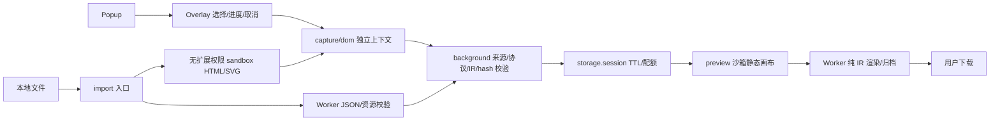

# v0.3 实际架构 · Decision

源码使用原生 ES modules，无前端框架、后端或生产 npm 库。esbuild 只将内容脚本和隔离导入器打成两个随包分发的 IIFE；其他扩展页使用本地 ESM。

## 数据流与职责

| 文件 | 唯一职责 |
|---|---|
| `src/capture/picker.js` | 选容器、Overlay、清理监听、独立 AbortController、进度与重试 |
| `src/capture/dom.js` | 有界 DOM→树/样式/资源；每次新 omissions/stats/id 映射；不负责格式 |
| `src/core/policy.js` | 标签、属性、样式与 CSS 函数白名单、本地 SVG 引用规则 |
| `src/core/ir.js` / `raster.js` | 版本、契约、有限状态、哈希/签名/编码像素检查、迁移、纯诊断 |
| `src/core/render.js` | 校验后的 IR→HTML/Markdown/JSON/SVG；不访问原网站 |
| `src/core/archive.js` | 确定性 ZIP STORE/CRC32、文件 SHA-256/manifest |
| `src/core/session.js` | TTL、最多3份、保守配额与淘汰 |
| `background.js` | 发送者/消息/来源验证、串行会话写入、创建预览 |
| `import.js` / `src/import-sandbox.js` | 本地文件路由；未净化 HTML 永不进入有扩展权限 DOM |
| `src/jobs.js` / `src/worker.js` | 独立 Worker 校验/序列化/ZIP；超10秒 terminate |
| `preview.js` | 展示、格式最新任务隔离、有限 PNG、显式下载与过期状态 |

## Snapshot IR 1.0.0

机器结构见 [snapshot.schema.json](snapshot.schema.json)，完整安全语义以 `validateSnapshot` + `verifyResources` 为准。JSON Schema 不能代替样式函数、标签/属性组合、引用一致性和资源 hash 校验；CI 检查 schema 生成无漂移。

顶层：schemaVersion/kind、创建时间、来源类型与脱敏 origin、dimensions/background、tree、resources、provenance、capability、omissions、limitations、security、可选 stats。来源不保存查询串、路径、文件名或身份。节点含白名单 tag/ns/attrs/style/children、组件类型、有限滚动状态和来源 evidence；资源为允许栅格的 base64/MIME/SHA-256，不接收远程地址。

来源方法区分 DOM、local-file、raster-import、migrated-v02。节点 `captured` 和 `unsupported` 显式区分；当前拒绝 `reconstructed`，未来须引入有证据的版本/渲染器。能力仅 `static` 或 `visual-only`；拒绝伪造的 state-preserved/reconstructed-tested。有限状态记录不等于原生逻辑复原。它不是 ChatGPT 原生组件协议。

当前版本读写往返稳定；未知版本失败关闭。v0.2 `static-snapshot` 的 HTML 必须重新通过隔离净化，缺失结构/状态不可恢复。未来新增 schema 必须显式迁移、兼容测试；不可悄悄将未知版本当当前版。

## 生命周期与有界处理

新增 `storage` 有必要性：SW 内存 Map 无法跨休眠恢复。只使用 `storage.session`，访问级别 TRUSTED_CONTEXTS；浏览器会话内保留，未写 local/sync。每条消息先验证发送者 id、页 URL/顶层 frame 与字段；capture 只允许允许的网页内容脚本或本地 importer，getCapture 只允许 preview。内容来源 origin 必须与 sender 一致。

保存最多3份；估算 UTF-8序列化×2 总量不超过7,500,000字节，以低于10MB API配额留余量。10分钟后拒绝读取；下一条消息清理过期记录，预览定时禁用下载并移除画布。没有 alarms 定时物理清理或安全擦除承诺。会话结束/扩展重载可更早失效。

| 边界 | 实施 |
|---|---|
| DOM/IR | 最多5000访问节点、75层、100万文本字符、4MB序列化IR |
| 尺寸 | 单轴1–12000；Canvas/栅格最多100万像素、单轴4096 |
| 文件 | HTML/SVG/图片2MB，JSON4MB；单资源base64≤200万字符，捕获资源总≤250万字符 |
| DOM遍历 | 预检入栈即限制总节点；每64节点让出，捕获每16节点让出并查取消 |
| Worker | 可 terminate 的10秒超时；每次独立任务，不共享不可信状态 |
| sandbox | 独立无权限 frame，15秒移除；浏览器单次原生同步调用不能保证硬抢占 |

单次 computedStyle、Canvas、解码与 DOMParser 属浏览器原生调用；协作取消不是硬 CPU 超时。图片先读编码尺寸再解码；文件/树/像素限额降低峰值，不能承诺任意敌意网页在共享渲染线程绝不卡顿。

## 导出封装

HTML 固定画布、来源样式、禁止网络/脚本的 CSP；SVG 属性和函数级净化，不依赖 HTML CSP。预览空 sandbox。MD 结构渲染；不内嵌执行脚本。PNG 仅 SVG 根或已有 PNG；HTML 截图未实现。

ZIP 含 index.html、snapshot.json、notes.md、diagnostic.json、已获得的 resources/、可用的 graphic.svg、manifest.json、SHA256SUMS。manifest列实际内容文件的 bytes/hash，SHA256SUMS再覆盖manifest；两者不自引用。只封装已验证资源，无抓取。诊断接口不含 tree/正文/HTML/资源data；JSON下载明确是完整快照。

构建信息的 revision 是构建基准提交，workingTreeModified 标注是否含未提交内容；sourceDigest/逐文件hash才定义实际构建。测试前后 hash 必须一致；打包再次比对测试证明，拒绝过期产物。
